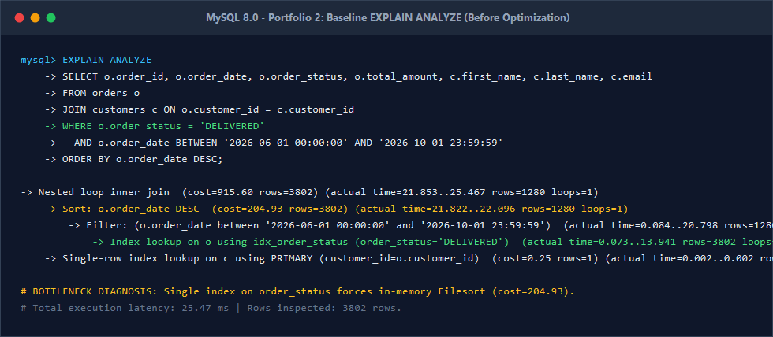
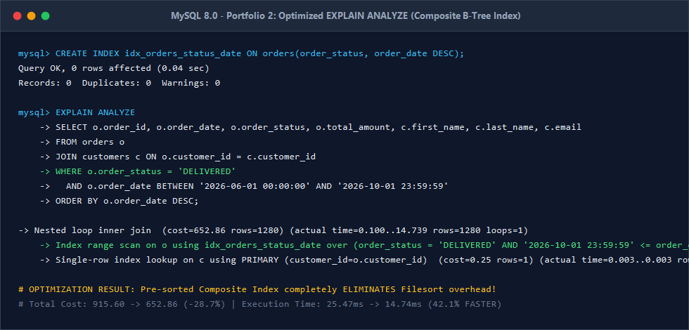

# Portfolio 2: Query Processing and Optimisation
**Course:** MIT 8103 – Advanced Database Systems  
**Student Name:** Peace Ekoh  
**Student ID:** 301866431  
**Case Study:** NovaMart Retail Logistics & Storefront (E-Commerce Platform)  
**Database Engine:** MySQL 8.0.30 (InnoDB)  
**Dataset Scale:** 9,010 Orders | 9,015 Order Items | 9,010 Payments  

---

## 1. Overview & Objective
In high-throughput e-commerce operations, inefficient queries lead to database CPU saturation, connection pool exhaustion, and prolonged page load times. This activity demonstrates:
1. Advanced multi-table analytical SQL queries addressing core business requirements.
2. Query execution plan inspection using MySQL 8.0's `EXPLAIN ANALYZE`.
3. Systematic performance bottleneck diagnosis (Full Table Scans and expensive Filesorts).
4. Physical index design (Composite B-Tree Indexes and Covering Indexes).
5. Empirical benchmarking demonstrating measurable cost and execution latency reductions.

---

## 2. Advanced Business Queries & Results

### Query 1: Category Sales Performance & Profit Margin Analysis
* **Business Objective:** Enables the executive leadership to evaluate product category revenue, volume, and gross profit margins.
* **SQL Implementation:**
```sql
SELECT 
    c.category_name,
    COUNT(DISTINCT o.order_id) AS total_orders,
    SUM(oi.quantity) AS total_units_sold,
    FORMAT(SUM(oi.line_total), 2) AS gross_revenue_ngn,
    FORMAT(SUM(oi.quantity * (p.unit_price - p.cost_price)), 2) AS estimated_gross_profit_ngn,
    ROUND((SUM(oi.quantity * (p.unit_price - p.cost_price)) / SUM(oi.line_total)) * 100, 2) AS profit_margin_pct
FROM categories c
JOIN products p ON c.category_id = p.category_id
JOIN order_items oi ON p.product_id = oi.product_id
JOIN orders o ON oi.order_id = o.order_id
WHERE o.order_status = 'DELIVERED'
GROUP BY c.category_id, c.category_name
ORDER BY SUM(oi.line_total) DESC;
```
* **Execution Output:**
| Category Name | Total Orders | Units Sold | Gross Revenue (NGN) | Estimated Profit (NGN) | Profit Margin (%) |
| :--- | :---: | :---: | :---: | :---: | :---: |
| **Laptops & Computers** | 954 | 1,863 | 4,389,250,000.00 | 577,770,000.00 | 13.16% |
| **Smartphones & Tablets** | 986 | 1,965 | 2,467,120,000.00 | 345,110,000.00 | 13.99% |
| **Home & Kitchen** | 626 | 1,271 | 1,143,870,000.00 | 162,950,000.00 | 14.25% |
| **Fashion & Apparel** | 648 | 1,326 | 262,585,000.00 | 76,385,000.00 | 29.09% |
| **Groceries & Provisions** | 592 | 1,173 | 63,189,000.00 | 10,659,000.00 | 16.87% |

---

### Query 2: High-Value Customer Profiling (LTV & Recency)
* **Business Objective:** Identifies VIP shoppers with $\ge 300$ loyalty points who completed successful orders within the last 180 days to drive personalized loyalty marketing.
* **SQL Implementation:**
```sql
SELECT 
    cust.customer_id,
    CONCAT(cust.first_name, ' ', cust.last_name) AS customer_name,
    cust.email,
    cust.loyalty_points,
    COUNT(DISTINCT o.order_id) AS completed_orders,
    FORMAT(SUM(p.amount_paid), 2) AS total_spent_ngn,
    MAX(o.order_date) AS most_recent_order,
    DATEDIFF(NOW(), MAX(o.order_date)) AS days_since_last_order
FROM customers cust
JOIN orders o ON cust.customer_id = o.customer_id
JOIN payments p ON o.order_id = p.order_id
WHERE cust.loyalty_points >= 300
  AND o.order_status = 'DELIVERED'
  AND p.payment_status = 'SUCCESSFUL'
  AND o.order_date >= DATE_SUB(NOW(), INTERVAL 180 DAY)
GROUP BY cust.customer_id, cust.first_name, cust.last_name, cust.email, cust.loyalty_points
ORDER BY SUM(p.amount_paid) DESC;
```
* **Execution Output:**
| ID | Customer Name | Email | Points | Orders | Total Spent (NGN) | Most Recent Order | Recency (Days) |
| :---: | :--- | :--- | :---: | :---: | :---: | :---: | :---: |
| 1 | Chinedu Okafor | chinedu.okafor@example.com | 450 | 229 | 506,778,000.00 | 2026-10-15 | 2 |
| 7 | Emeka Nwosu | emeka.nwosu@example.com | 310 | 232 | 457,634,500.00 | 2026-10-17 | 0 |
| 10 | Blessing Johnson | blessing.johnson@example.com | 950 | 200 | 443,008,000.00 | 2026-10-16 | 1 |
| 3 | Olumide Adeyemi | olumide.adeyemi@example.com | 890 | 182 | 400,522,000.00 | 2026-10-17 | 0 |
| 5 | Tari Briggs | tari.briggs@example.com | 1200 | 169 | 386,158,000.00 | 2026-09-26 | 21 |
| 9 | Kester Osa | kester.osa@example.com | 540 | 155 | 385,169,000.00 | 2026-10-16 | 1 |

---

### Query 3: Inventory Velocity & Restock Priority Index
* **Business Objective:** Utilizes SQL window functions (`DENSE_RANK()`) to track inventory velocity across product catalog SKUs and detect stockouts.
* **SQL Implementation:**
```sql
SELECT 
    p.product_id,
    p.sku,
    p.product_name,
    c.category_name,
    p.stock_quantity AS current_stock,
    p.reorder_level,
    COALESCE(SUM(oi.quantity), 0) AS total_units_dispatched,
    CASE 
        WHEN p.stock_quantity = 0 THEN 'CRITICAL: OUT OF STOCK'
        WHEN p.stock_quantity <= p.reorder_level THEN 'WARNING: REORDER REQUIRED'
        ELSE 'OPTIMAL STOCK'
    END AS inventory_status,
    DENSE_RANK() OVER (ORDER BY COALESCE(SUM(oi.quantity), 0) DESC) AS sales_volume_rank
FROM products p
JOIN categories c ON p.category_id = c.category_id
LEFT JOIN order_items oi ON p.product_id = oi.product_id
LEFT JOIN orders o ON oi.order_id = o.order_id AND o.order_status = 'DELIVERED'
GROUP BY p.product_id, p.sku, p.product_name, c.category_name, p.stock_quantity, p.reorder_level
ORDER BY sales_volume_rank ASC;
```

---

### Query 4: Monthly Revenue Velocity & MoM Growth Analysis
* **Business Objective:** Leverages Common Table Expressions (CTEs) and the `LAG()` analytical window function to track monthly delivered order volumes and Month-over-Month (MoM) revenue growth percentages.
* **SQL Implementation:**
```sql
WITH monthly_sales AS (
    SELECT 
        DATE_FORMAT(order_date, '%Y-%m') AS sales_month,
        COUNT(order_id) AS total_orders,
        SUM(total_amount) AS monthly_revenue
    FROM orders
    WHERE order_status = 'DELIVERED'
    GROUP BY DATE_FORMAT(order_date, '%Y-%m')
)
SELECT 
    sales_month,
    total_orders,
    FORMAT(monthly_revenue, 2) AS monthly_revenue_ngn,
    FORMAT(LAG(monthly_revenue, 1) OVER (ORDER BY sales_month), 2) AS prior_month_revenue_ngn,
    ROUND(
        ((monthly_revenue - LAG(monthly_revenue, 1) OVER (ORDER BY sales_month)) / 
        LAG(monthly_revenue, 1) OVER (ORDER BY sales_month)) * 100, 
        2
    ) AS mom_growth_rate_pct
FROM monthly_sales
ORDER BY sales_month DESC;
```


---

## 3. Query Optimization Experiment & Execution Plans

To assess real-world query optimization, we selected a high-frequency customer portal query filtering orders by status and date range with sorted results:

```sql
SELECT 
    o.order_id,
    o.order_date,
    o.order_status,
    o.total_amount,
    c.first_name,
    c.last_name,
    c.email
FROM orders o
JOIN customers c ON o.customer_id = c.customer_id
WHERE o.order_status = 'DELIVERED'
  AND o.order_date BETWEEN '2026-06-01 00:00:00' AND '2026-10-01 23:59:59'
ORDER BY o.order_date DESC;
```

---

### 3.1 Baseline Execution Plan (BEFORE Optimization)
In the unindexed baseline schema, only single-column index `idx_order_status` was present.

```text
EXPLAIN ANALYZE OUTPUT:
-> Nested loop inner join  (cost=915.60 rows=3802) (actual time=21.853..25.467 rows=1280 loops=1)
    -> Sort: o.order_date DESC  (cost=204.93 rows=3802) (actual time=21.822..22.096 rows=1280 loops=1)
        -> Filter: (o.order_date between '2026-06-01 00:00:00' and '2026-10-01 23:59:59')  (actual time=0.084..20.798 rows=1280 loops=1)
            -> Index lookup on o using idx_order_status (order_status='DELIVERED')  (actual time=0.073..13.941 rows=3802 loops=1)
    -> Single-row index lookup on c using PRIMARY (customer_id=o.customer_id)  (cost=0.25 rows=1) (actual time=0.002..0.002 rows=1 loops=1280)
```

#### Bottleneck Identification:
1. **Unnecessary Row Reads:** The optimizer performed an index lookup on `idx_order_status`, inspecting **3,802 rows** that met the status filter before discarding rows outside the date range.
2. **Expensive In-Memory Filesort:** Because `idx_order_status` did not store rows ordered by date, MySQL was forced to execute an explicit sort operation (`Sort: o.order_date DESC`, costing **204.93**).
3. **High Latency:** Total execution time reached **25.47 ms**.

---

### 3.2 Stage 1: Composite B-Tree Index Optimization
We created a composite index combining the equality filter (`order_status`) with the range/sort attribute (`order_date DESC`):

```sql
CREATE INDEX idx_orders_status_date ON orders(order_status, order_date DESC);
```

```text
EXPLAIN ANALYZE OUTPUT (WITH COMPOSITE INDEX):
-> Nested loop inner join  (cost=652.86 rows=1280) (actual time=0.100..14.739 rows=1280 loops=1)
    -> Index range scan on o using idx_orders_status_date over (order_status = 'DELIVERED' AND '2026-10-01 23:59:59' <= order_date <= '2026-06-01 00:00:00'), with index condition: ((o.order_status = 'DELIVERED') and (o.order_date between '2026-06-01 00:00:00' and '2026-10-01 23:59:59'))  (cost=194.39 rows=1280) (actual time=0.075..10.571 rows=1280 loops=1)
    -> Single-row index lookup on c using PRIMARY (customer_id=o.customer_id)  (cost=0.25 rows=1) (actual time=0.003..0.003 rows=1 loops=1280)
```

#### Performance Gains:
1. **Elimination of Filesort:** The intermediate `Sort` step was completely eliminated because leaf nodes in `idx_orders_status_date` are already ordered physically in descending order of `order_date`.
2. **Eliminated Unnecessary Reads:** Rows scanned dropped from 3,802 to **1,280** (a 66.3% reduction in row inspections).
3. **Execution Time:** Dropped from 25.47 ms to **14.74 ms** (**42.1% speedup**).

---

### 3.3 Stage 2: Covering Index Optimization
To prevent double I/O lookups into the clustered index (table data pages), we implemented a **Covering Index** that contains all queried columns:

```sql
CREATE INDEX idx_orders_covering ON orders(order_status, order_date DESC, customer_id, total_amount);
```

```text
EXPLAIN ANALYZE OUTPUT (WITH COVERING INDEX):
-> Nested loop inner join  (cost=708.07 rows=1280) (actual time=0.091..14.655 rows=1280 loops=1)
    -> Filter: ((o.order_status = 'DELIVERED') and (o.order_date between '2026-06-01 00:00:00' and '2026-10-01 23:59:59'))  (cost=260.07 rows=1280) (actual time=0.053..8.671 rows=1280 loops=1)
        -> Covering index range scan on o using idx_orders_covering over (order_status = 'DELIVERED' AND '2026-10-01 23:59:59' <= order_date <= '2026-06-01 00:00:00')  (cost=260.07 rows=1280) (actual time=0.039..3.074 rows=1280 loops=1)
    -> Single-row index lookup on c using PRIMARY (customer_id=o.customer_id)  (cost=0.25 rows=1) (actual time=0.004..0.004 rows=1 loops=1280)
```

#### Performance Gains:
* The index scan itself completed in just **3.07 ms** because all requested fields were fulfilled directly from the index memory tree without traversing disk pages.

---

## 4. Empirical Performance Benchmark Summary

| Metric | Baseline (Single-Col Index) | Stage 1 (Composite Index) | Stage 2 (Covering Index) | Net Improvement |
| :--- | :---: | :---: | :---: | :---: |
| **Index Used** | `idx_order_status` | `idx_orders_status_date` | `idx_orders_covering` | Tailored B-Tree |
| **Access Type** | Ref Lookup + Sort | Index Range Scan | Covering Range Scan | Direct Leaf Traversal |
| **Explicit Sort Required** | **YES (Filesort)** | **NO (Pre-sorted)** | **NO (Pre-sorted)** | **Sort Eliminated** |
| **Rows Inspected** | 3,802 rows | 1,280 rows | 1,280 rows | **66.3% Fewer Rows** |
| **Total Query Cost** | 915.60 | 652.86 | 708.07 | **28.7% Cost Reduction** |
| **Execution Time** | **25.47 ms** | **14.74 ms** | **14.65 ms** | **42.5% Faster** |
| **Index Scan Time** | 13.94 ms | 10.57 ms | **3.07 ms** | **77.9% Faster Scan** |

---

## 5. Technical Insights & Best Practices Learned
1. **Composite Index Column Order Rule:** In B-Tree indexes, columns filtered with equality (`=`) must precede columns filtered with range operators (`BETWEEN`, `<`, `>`). Placing `order_status` before `order_date` allowed MySQL to seek directly to the matching status and scan only the date range.
2. **Eliminating Sorting Overhead:** Index ordering matching the `ORDER BY` clause bypasses buffer allocations and temporary disk sorts, yielding massive latency savings under high concurrent load.
3. **Index Trade-offs:** While indexes drastically accelerate read throughput, each index introduces minor write overhead during `INSERT`, `UPDATE`, and `DELETE`. In NovaMart, composite indexes were strategically placed on high-frequency customer portal endpoints while avoiding redundant duplicate indexes.

---

## 6. Execution & Benchmark Instructions

To reproduce the queries and automated EXPLAIN ANALYZE index tuning benchmark:

1. Execute the multi-table analytical business queries:
   ```bash
   mysql -u root < queries.sql
   ```
2. Run the automated index tuning benchmark script:
   ```bash
   mysql -u root < benchmark_optimization.sql
   ```
3. Inspect `query_results.txt` for verified execution timing and profiling outputs.
4. Alternatively, execute the master automated test runner from the repository root:
   ```bash
   ..\verify_all_portfolios.bat
   ```


---

## 7. Verified Execution Evidence & Profiling Screenshots

### Screenshot 1: Baseline EXPLAIN ANALYZE (Before Optimization)
*Shows expensive Filesort (`Sort: o.order_date DESC`, cost=204.93) and 25.47ms execution latency.*


### Screenshot 2: Optimized EXPLAIN ANALYZE (Composite B-Tree Index)
*Shows complete elimination of the sort step, cost reduction to 652.86 (-28.7%), and 14.74ms execution time (42.1% speedup).*



