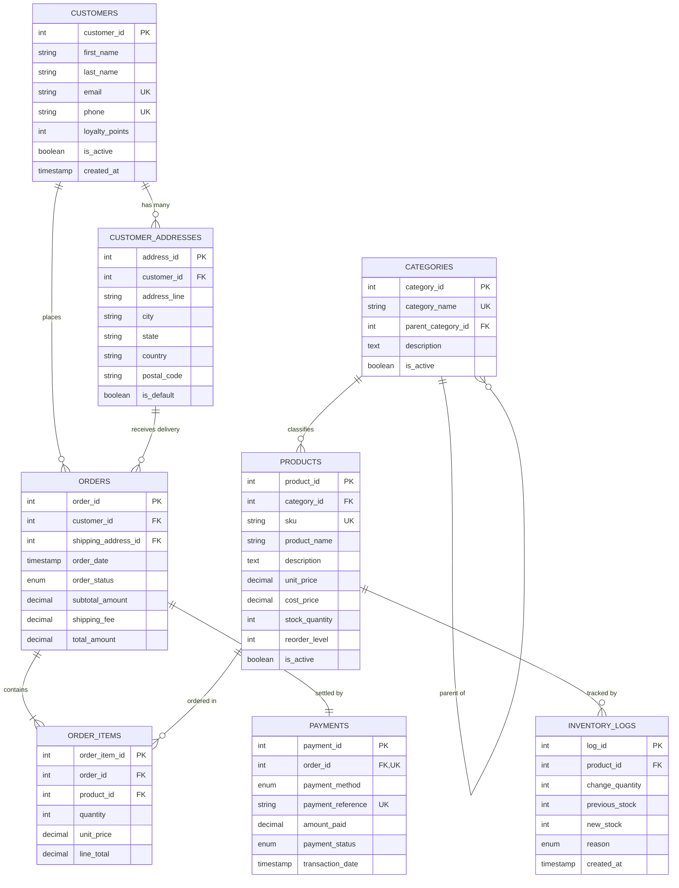

# Portfolio 1: Database Design and Modelling
**Course:** MIT 8103 – Advanced Database Systems  
**Student Name:** Peace Ekoh  
**Student ID:** 301866431  
**Case Study:** NovaMart Retail Logistics & Storefront (E-Commerce Platform)  

---

## 1. Case Study Specification

### 1.1 Business Background
**NovaMart** is an online omnichannel retail platform serving urban and regional consumers across West Africa. The enterprise distributes consumer electronics, personal computing, home appliances, fashion apparel, and FMCG groceries. 

The database powers core transactional operations including:
* Customer registration, profile management, and multiple shipping addresses.
* Hierarchical product catalog management with category trees and stock tracking.
* High-volume checkout and order line item dispatch.
* Real-time payment verification and financial reconciliation.
* Real-time stock decrement and inventory audit logging.

### 1.2 Target Stakeholders & Database Users
| User Role | Operations on Database |
| :--- | :--- |
| **End-User / Customer** | Searches catalog, filters products by category, maintains addresses, creates orders, executes payments. |
| **Inventory / Warehouse Staff** | Monitors reorder thresholds, restocks items, logs product shipments and returns. |
| **Finance / Order Fulfillment** | Verifies payment references, marks orders as `CONFIRMED`, `SHIPPED`, or `DELIVERED`. |
| **System Administrator / DBA** | Manages schema integrity, enforces ACID transactions, tunes indexes, monitors replication. |

---

## 2. Entity-Relationship (ER) Diagram

The following conceptual and logical relationships govern NovaMart:



---

## 3. Relational Schema & Integrity Constraints

The relational schema is implemented in MySQL 8.0 using the **InnoDB** storage engine to guarantee ACID reliability and referential integrity.

### 3.1 Primary and Foreign Key Architecture
1. **`customers` Table:**
   - **Primary Key:** `customer_id` (`INT AUTO_INCREMENT`).
   - **Unique Constraints:** `email` (`VARCHAR(100)`), `phone` (`VARCHAR(20)`).
   - **Domain Constraints:** `loyalty_points >= 0`.

2. **`customer_addresses` Table:**
   - **Primary Key:** `address_id`.
   - **Foreign Key:** `customer_id` $\rightarrow$ `customers(customer_id)` (`ON DELETE CASCADE`).

3. **`categories` Table:**
   - **Primary Key:** `category_id`.
   - **Foreign Key (Self-Referencing):** `parent_category_id` $\rightarrow$ `categories(category_id)` (`ON DELETE SET NULL`). Supports unlimited category hierarchies (e.g., Electronics $\rightarrow$ Laptops).

4. **`products` Table:**
   - **Primary Key:** `product_id`.
   - **Foreign Key:** `category_id` $\rightarrow$ `categories(category_id)` (`ON DELETE RESTRICT`).
   - **Unique Constraints:** `sku` (`VARCHAR(50)`).
   - **Check Constraints:** `unit_price > 0`, `cost_price > 0`, `stock_quantity >= 0`, `reorder_level >= 0`.

5. **`orders` Table:**
   - **Primary Key:** `order_id`.
   - **Foreign Keys:**
     - `customer_id` $\rightarrow$ `customers(customer_id)` (`ON DELETE RESTRICT`).
     - `shipping_address_id` $\rightarrow$ `customer_addresses(address_id)` (`ON DELETE RESTRICT`).
   - **Enumeration:** `order_status` in `('PENDING', 'CONFIRMED', 'PROCESSING', 'SHIPPED', 'DELIVERED', 'CANCELLED')`.

6. **`order_items` Table:**
   - **Primary Key:** `order_item_id`.
   - **Foreign Keys:**
     - `order_id` $\rightarrow$ `orders(order_id)` (`ON DELETE CASCADE`).
     - `product_id` $\rightarrow$ `products(product_id)` (`ON DELETE RESTRICT`).
   - **Unique Composite Constraint:** `UNIQUE(order_id, product_id)` ensures a product cannot be duplicated as separate lines in the same order.
   - **Generated Virtual Column:** `line_total AS (quantity * unit_price) STORED`.

7. **`payments` Table:**
   - **Primary Key:** `payment_id`.
   - **Foreign Key / One-to-One:** `order_id` $\rightarrow$ `orders(order_id)` (`UNIQUE`).
   - **Unique Constraint:** `payment_reference`.

---

## 4. Normalisation Analysis & Proof

To eliminate data redundancy, insertion anomalies, update anomalies, and deletion anomalies, NovaMart was designed through systematic normalisation from Unnormalised Form (UNF) through to Third Normal Form (3NF) and Boyce-Codd Normal Form (BCNF).

### 4.1 Unnormalised Form (UNF)
In an unnormalised legacy invoice system, all order data was recorded in a single flat structure:
$$\text{OrderRecord} = \{\underline{\text{OrderID}}, \text{Date}, \text{CustName}, \text{CustEmail}, \text{CustAddress}, \{\text{ProdID}, \text{ProdName}, \text{CatName}, \text{Qty}, \text{Price}\}, \text{PayRef}, \text{PayStatus}\}$$

* **Problems:** Repeating groups of products inside each order row, repeated customer address text, risk of inconsistent category names.

### 4.2 First Normal Form (1NF)
> **Definition:** A relation is in 1NF if and only if all attribute values are atomic (indivisible) and there are no repeating groups.

* **Transformation:**
  1. Removed the repeating items collection by splitting into two relations: `ORDERS` and `ORDER_ITEMS`.
  2. Multi-valued customer addresses were extracted into an independent `CUSTOMER_ADDRESSES` table so customers can register multiple delivery points without comma-separated fields.
  3. Customer names were split into atomic components (`first_name`, `last_name`).

### 4.3 Second Normal Form (2NF)
> **Definition:** A relation is in 2NF if it is in 1NF and every non-prime attribute is fully functionally dependent on the entire primary key (no partial key dependencies).

* **Analysis:**
  * In the composite relation `(order_id, product_id) \rightarrow (quantity, unit_price, product_name, category_name)`.
  * `product_name` and `category_name` depend *only* on `product_id`, not on `order_id`. This was a **partial key dependency**.
* **Resolution:**
  * Separated product catalog attributes into the `products` table where `product_id \rightarrow (product_name, base_price, stock_quantity)`.
  * Kept only the transaction-specific values (`quantity`, historical `unit_price`, `line_total`) inside `order_items`.

### 4.4 Third Normal Form (3NF) & BCNF
> **Definition:** A relation is in 3NF if it is in 2NF and no non-prime attribute is transitively dependent on the primary key ($X \rightarrow Y$ and $Y \rightarrow Z$, where $X$ is the primary key).

* **Analysis of Transitive Dependencies in NovaMart:**
  1. In `products`: `product_id \rightarrow category_id \rightarrow category_name`. Category information was transitively dependent on `product_id`.
     * **Fix:** Created a separate `categories` table. `products` retains only the foreign key `category_id`.
  2. In `orders`: `order_id \rightarrow customer_id \rightarrow (customer_email, customer_phone)`. 
     * If customer details were kept in `orders`, updating an email address would require updating dozens of historical order records (update anomaly).
     * **Fix:** Retained only `customer_id` and `shipping_address_id` inside `orders`.
  3. In `payments`: `order_id \rightarrow payment_reference \rightarrow payment_status`.
     * **Fix:** Payments is isolated into its own entity keyed on `payment_id` referencing `order_id`.

**Conclusion:** The schema satisfies 3NF and BCNF because for every functional dependency $X \rightarrow Y$, $X$ is a superkey.

---

## 5. Execution & Verification Instructions

To execute and verify this schema on your local MySQL server:

1. Open your terminal or Command Prompt.
2. Run the DDL script to create the database and tables:
   ```bash
   mysql -u root < schema.sql
   ```
3. Populate the tables with seed data:
   ```bash
   mysql -u root < seed_data.sql
   ```
4. Verify table creation and row counts:
   ```sql
   USE novamart_db;
   SHOW TABLES;
   SELECT 'customers' AS tbl, COUNT(*) FROM customers
   UNION ALL
   SELECT 'products', COUNT(*) FROM products
   UNION ALL
   SELECT 'orders', COUNT(*) FROM orders;
   ```
